# Communication Receiver DSP Testbench

A MATLAB and Simulink project for exploring receiver-side digital signal processing and known-signal detection under additive noise and narrowband interference.

The project develops a simple baseband BPSK receiver testbench that:

- generates a known BPSK burst,
- places it inside a longer observation frame,
- introduces additive white Gaussian noise (AWGN),
- adds narrowband sinusoidal interference,
- examines the received signal in the time and frequency domains,
- suppresses spectrally separated interference using an FIR low-pass filter,
- detects and localizes the known burst using correlation / matched filtering,
- applies threshold-based signal detection,
- evaluates probability of detection and false alarm versus SNR,
- investigates the effect of interference frequency,
- reproduces the receiver chain in Simulink using engineering scopes and spectrum analyzers.

The project is intended as a practical exploration of undergraduate communication and DSP concepts through implementation and experimentation.

---

## 1. Receiver Architecture

The receiver testbench follows the signal-processing chain:

```text
Known BPSK Burst
       ↓
AWGN Channel
       ↓
Narrowband Interference
       ↓
Spectrum Analysis
       ↓
FIR Interference Suppression
       ↓
Matched Filter / Correlation
       ↓
Magnitude
       ↓
Detection Threshold
       ↓
Detection Decision
```

### Simulink implementation

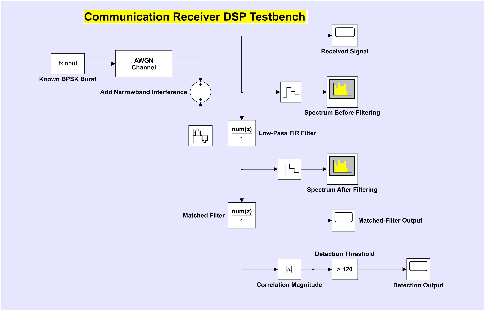

The Simulink model provides a visual implementation of the same receiver operations studied in the MATLAB experiments.

---

## 2. Project Objectives

The main objectives are to:

1. understand how a sampled baseband BPSK waveform is represented in MATLAB;
2. observe how AWGN affects a received digital waveform;
3. distinguish broadband noise from narrowband interference in the frequency domain;
4. design and verify an FIR filter for interference suppression;
5. understand correlation and matched filtering for known-signal detection;
6. detect whether a known burst is present and estimate its location;
7. evaluate detector performance statistically rather than from a single successful trial;
8. reproduce the receiver chain in Simulink using scopes and spectrum-analysis tools.

---

## 3. Baseline System

The initial receiver configuration uses:

| Parameter | Value |
|---|---:|
| Sampling frequency | 20 kHz |
| Symbol rate | 1 ksymbol/s |
| Samples per symbol | 20 |
| BPSK mapping | 1 → +1, 0 → -1 |
| Observation frame | 1000 samples |
| Known burst length | 200 samples |
| Baseline burst start | Sample 350 |
| Baseline SNR | 10 dB |
| Baseline interferer | 4 kHz sinusoid |
| Interference amplitude | 0.8 |
| FIR filter order | 80 |
| FIR cutoff frequency | 2 kHz |
| Initial detection threshold | 120 |

The known information sequence used in Version 1 is:

```text
1 0 1 1 0 0 1 0 1 0
```

---

## 4. Signal Model

The received signal is modeled as

```text
r[n] = s[n] + w[n] + i[n]
```

where:

- `s[n]` is the desired baseband BPSK burst,
- `w[n]` is additive white Gaussian noise,
- `i[n]` is narrowband sinusoidal interference.

The narrowband interferer is modeled as

```text
i[n] = Ai sin(2π fi n / Fs)
```

where `Ai` is the interference amplitude and `fi` is the interference frequency.

---

## 5. BPSK Signal Generation

Binary information is mapped to two baseband signal levels:

```text
bit 1 → +1
bit 0 → -1
```

With a sampling frequency of 20 kHz and symbol rate of 1 ksymbol/s,

```text
samples per symbol = Fs / Rs = 20
```

so each BPSK symbol is represented by 20 discrete samples.

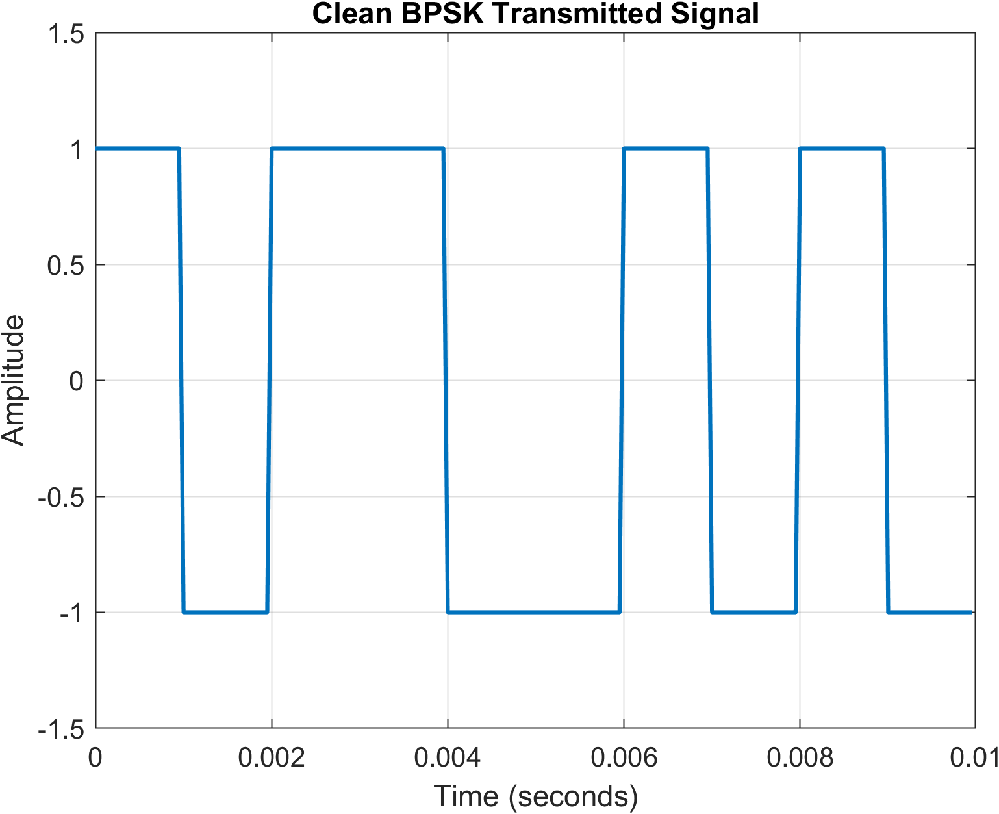

The burst is then inserted into a longer observation frame so the receiver must eventually determine whether the known pattern is present and where it occurs.

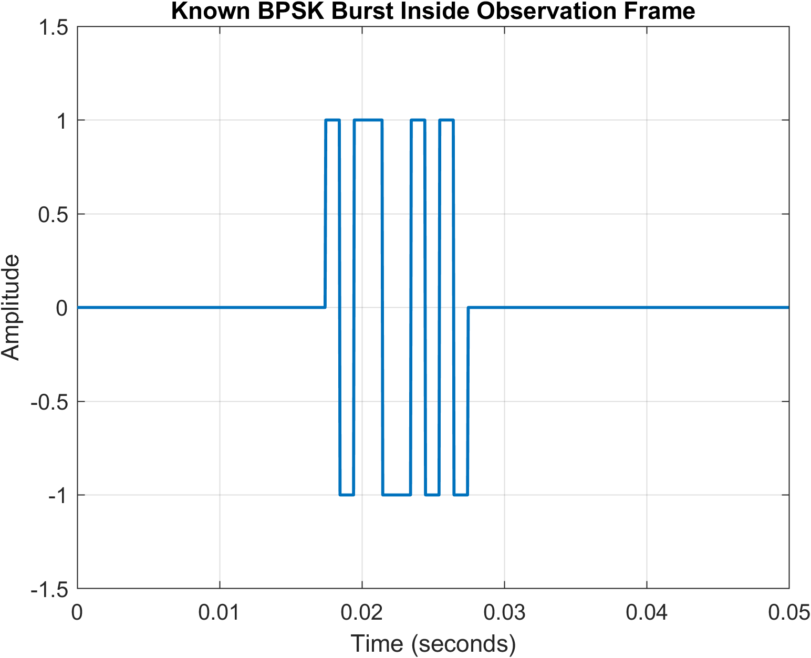

---

## 6. AWGN Experiment

AWGN is introduced at several SNR conditions to observe how receiver input quality changes as noise power increases.

For SNR in decibels,

```text
SNR(dB) = 10 log10(Psignal / Pnoise)
```

The project compares received waveforms at:

```text
20 dB
10 dB
0 dB
-5 dB
```

Example outputs are stored in:

```text
results/matlab/03_awgn_snr_+20dB.png
results/matlab/03_awgn_snr_+10dB.png
results/matlab/03_awgn_snr_0dB.png
results/matlab/03_awgn_snr_-5dB.png
```

As SNR decreases, the instantaneous BPSK waveform becomes progressively more difficult to distinguish visually.

---

## 7. Narrowband Interference

A sinusoidal interferer is added to the noisy receiver input.

The baseline interferer is located at:

```text
fi = 4 kHz
```

while the desired BPSK signal is represented at baseband.

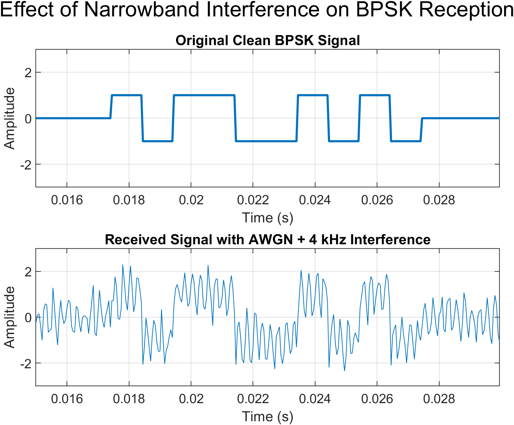

Unlike AWGN, whose energy is broadly distributed, the sinusoidal interferer produces a concentrated spectral component.

---

## 8. Frequency-Domain Analysis

The FFT is used to inspect the received signal in the frequency domain.

The progression is examined through:

1. clean baseband BPSK,
2. BPSK with AWGN,
3. BPSK with AWGN and the 4 kHz interferer.

### Clean BPSK spectrum

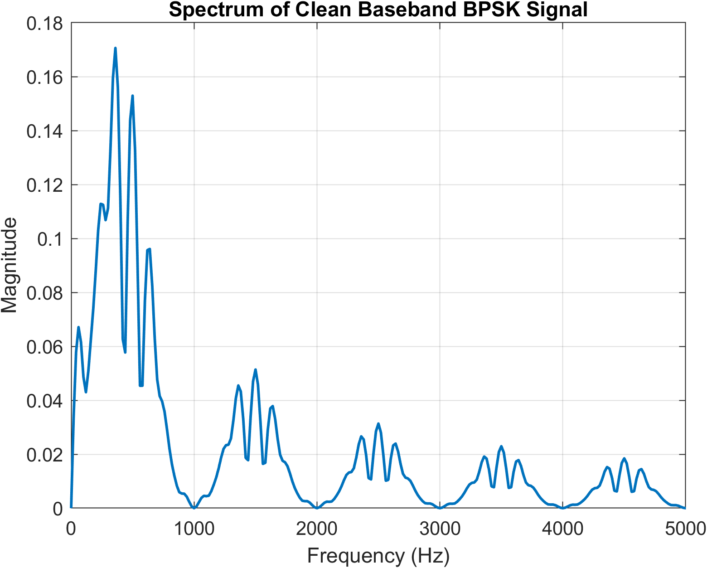

### BPSK with AWGN

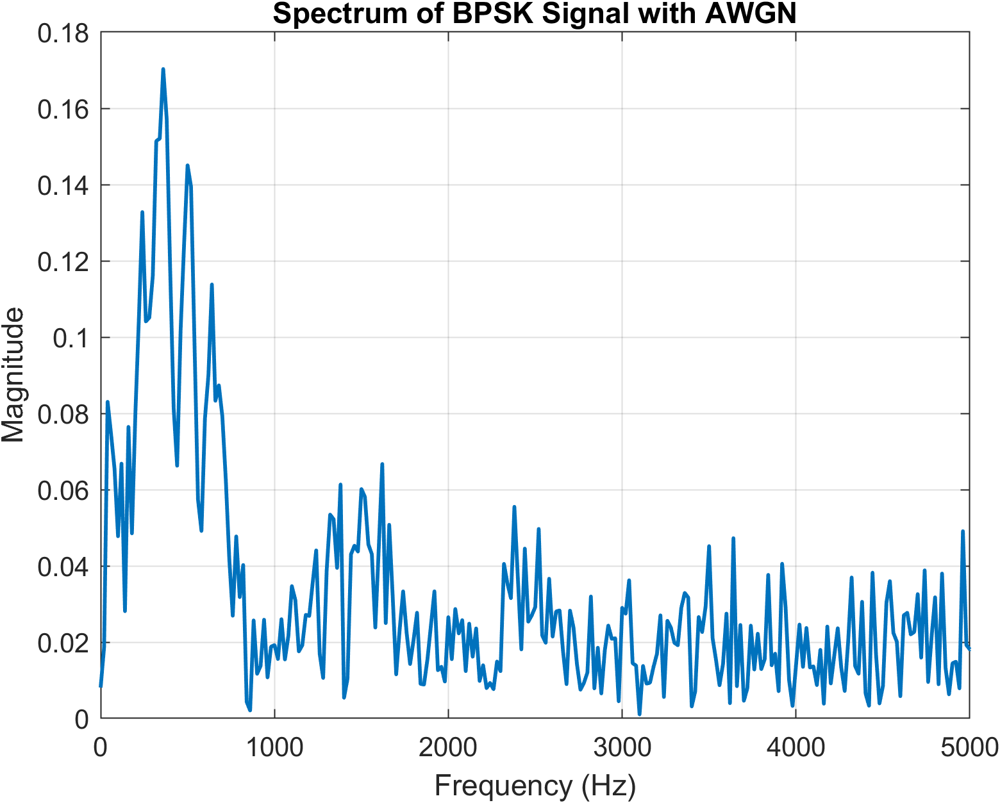

### BPSK with AWGN and narrowband interference

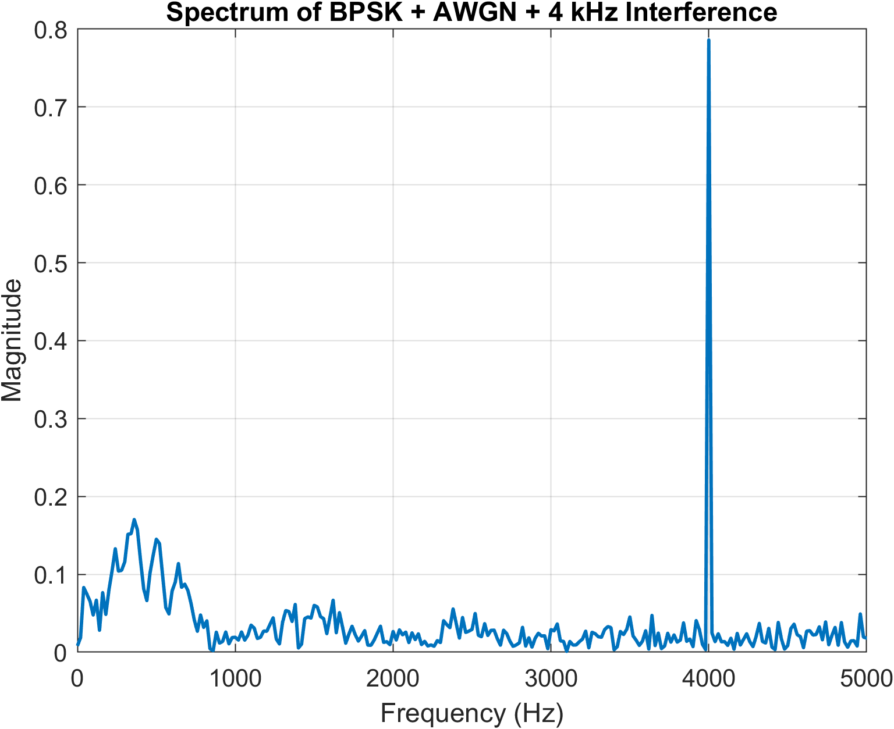

The narrowband interferer appears as a strong spectral component at approximately 4 kHz, while the useful rectangular-pulse BPSK waveform occupies a broader low-frequency baseband region.

---

## 9. FIR Interference Suppression

An 80th-order FIR low-pass filter is designed with a 2 kHz cutoff.

Its purpose is to preserve the useful low-frequency BPSK content while strongly attenuating the 4 kHz interferer.

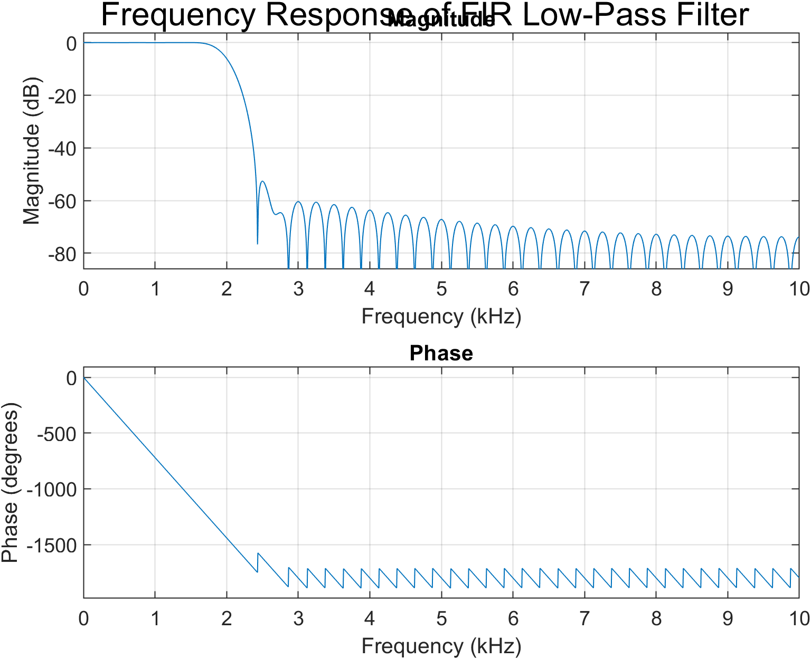

The filtering operation can be written as

```text
y[n] = Σ bk x[n-k]
```

where `bk` are the FIR filter coefficients.

### Before and after filtering

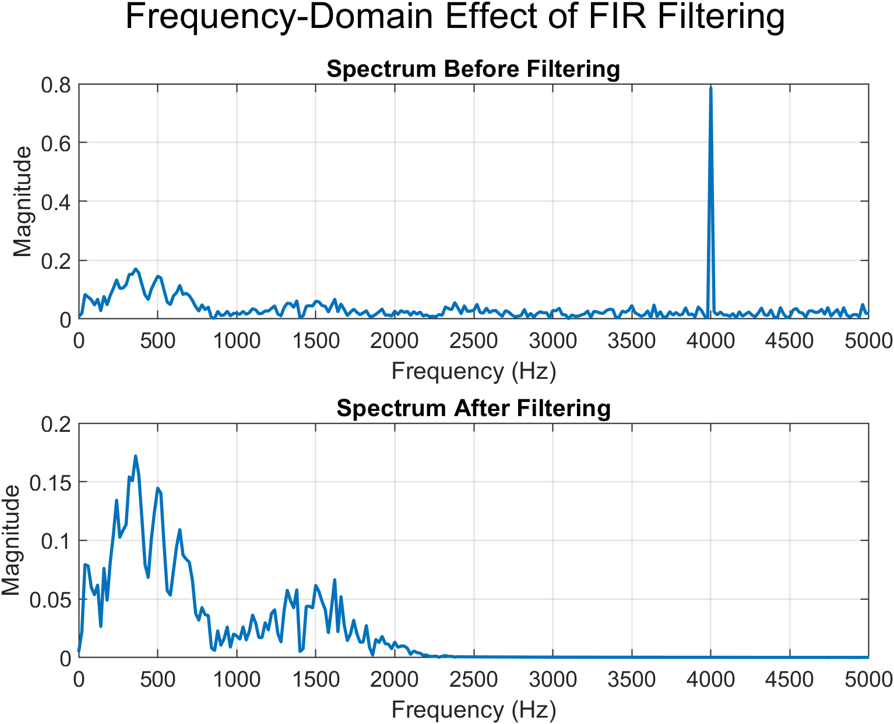

The measured 4 kHz spectral component was reduced by approximately:

```text
69.78 dB
```

in the baseline experiment.

The calculated FIR frequency response at 4 kHz in the later frequency-sensitivity experiment was approximately:

```text
-63.63 dB
```

These values represent different measurements: the first compares the measured received-signal spectral component before and after filtering, while the second evaluates the filter transfer function itself.

---

## 10. Correlation and Burst Localization

The receiver knows the waveform it is searching for.

The filtered received signal is correlated against the known BPSK reference sequence.

The strongest correlation occurs when the received burst and reference are aligned.

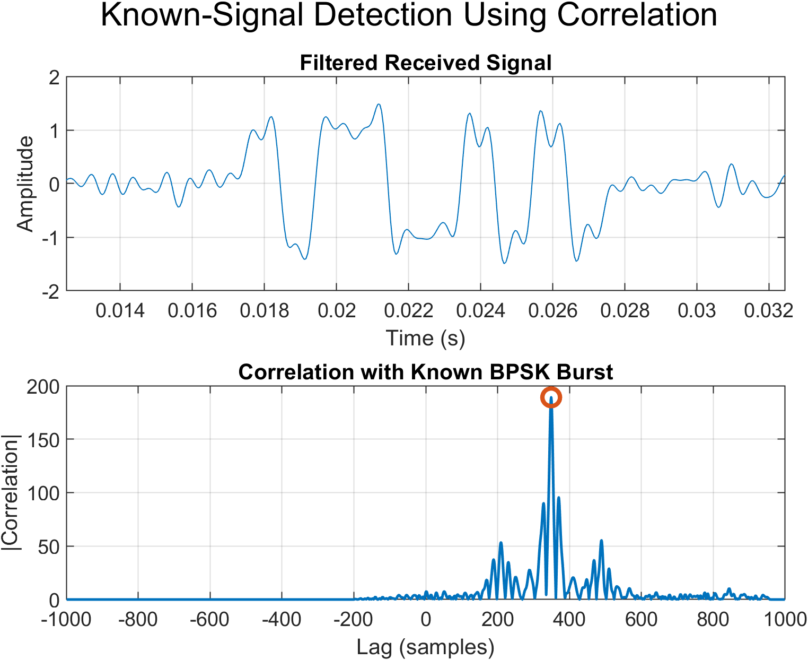

Baseline result:

| Metric | Result |
|---|---:|
| True burst start | 350 samples |
| Estimated burst start | 350 samples |
| Timing error | 0 samples |
| Peak correlation | 189.16 |

The zero-sample error represents the controlled baseline simulation and does not imply that perfect timing would always occur under more realistic impairments.

---

## 11. Threshold Detection

A correlation maximum always exists, even when the desired signal is absent.

Therefore, locating the largest correlation peak alone is not sufficient to declare that the signal exists.

The detector uses:

```text
peak correlation > threshold → signal detected
```

The initial Version 1 threshold is defined as 60% of the ideal clean reference energy.

The BPSK reference contains 200 samples with amplitudes ±1, giving:

```text
reference energy = 200
threshold = 0.60 × 200 = 120
```

This 60% value is a simple heuristic rather than an optimized detection threshold.

### Signal present

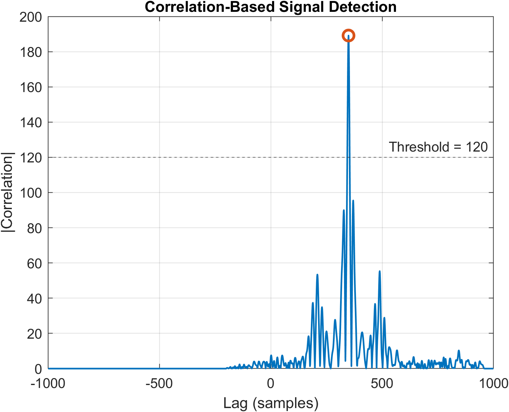

Measured result:

```text
Peak correlation = 189.16
Threshold        = 120
Decision         = SIGNAL DETECTED
```

### Signal absent

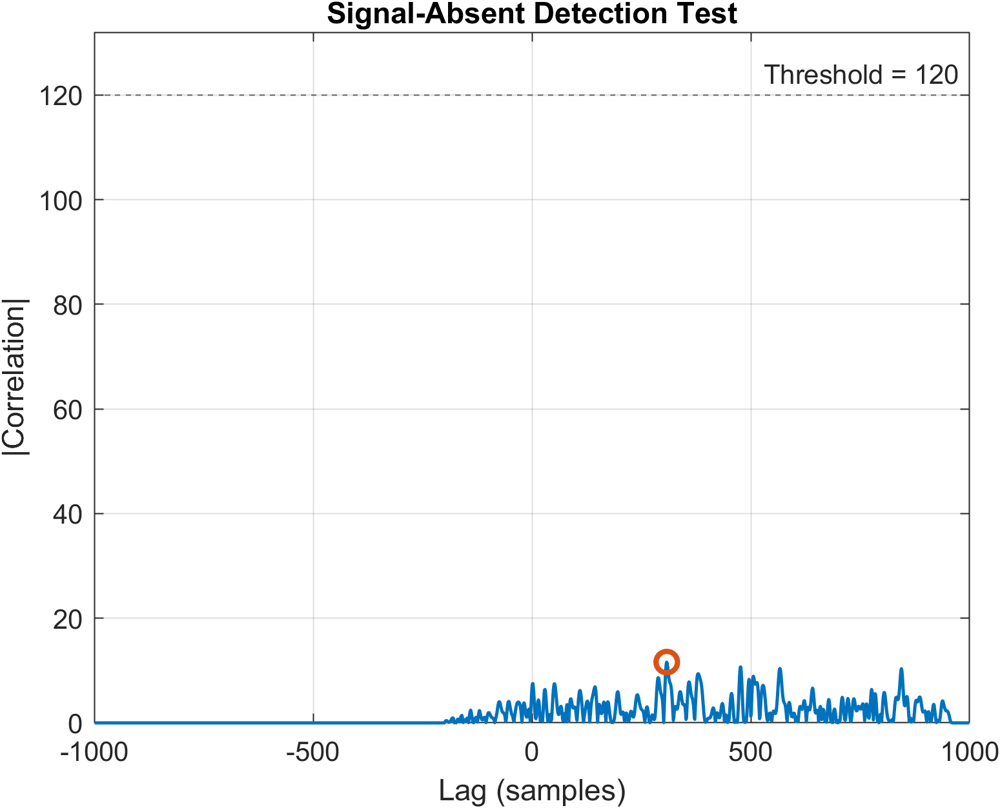

Measured result:

```text
Largest accidental peak = 11.62
Threshold               = 120
Decision                = NO SIGNAL DETECTED
```

This demonstrates the difference between locating the largest correlation value and determining whether that value is sufficiently strong to represent the desired signal.

---

## 12. Detection Performance versus SNR

The detector is evaluated over 500 Monte Carlo trials at each SNR condition.

Two metrics are used.

### Probability of Detection

```text
Pd = successful signal detections / signal-present trials
```

### Probability of False Alarm

```text
Pfa = false detections / signal-absent trials
```

Measured results:

| Nominal SNR (dB) | Pd | Pfa |
|---:|---:|---:|
| -20 | 1.000 | 1.000 |
| -15 | 1.000 | 1.000 |
| -10 | 0.978 | 0.562 |
| -5 | 0.990 | 0.000 |
| 0 | 1.000 | 0.000 |
| 5 | 1.000 | 0.000 |
| 10 | 1.000 | 0.000 |

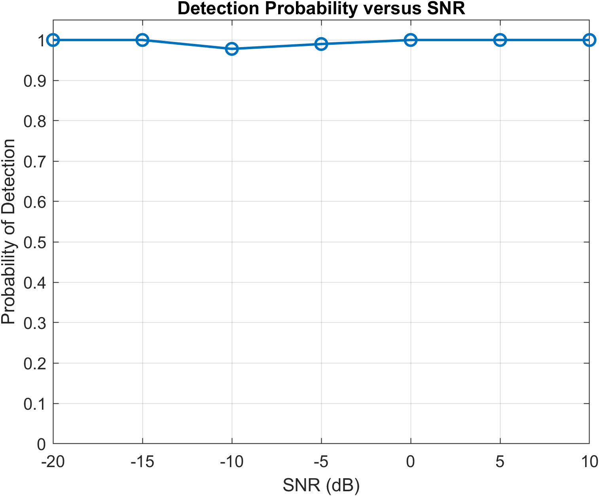

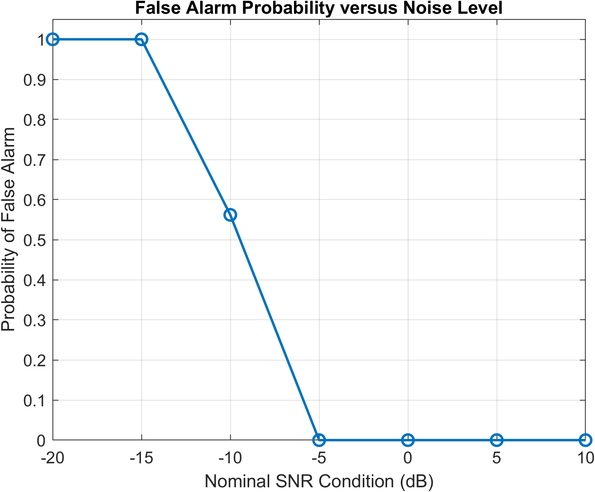

An important observation is that high `Pd` alone does not imply good detector performance.

At -20 dB and -15 dB:

```text
Pd = 1
Pfa = 1
```

meaning the detector effectively declares a signal almost all the time.

Under the present fixed-threshold configuration, performance becomes much more useful around -5 dB and above, where high detection probability is accompanied by zero observed false alarms in the simulated trials.

---

## 13. Interference-Frequency Sensitivity

A separate experiment moves the narrowband interferer toward the useful BPSK spectrum while keeping its amplitude fixed.

Test frequencies:

`1.0, 1.5, 2.0, 2.5, 3.0, and 4.0 kHz`

### Measured Results

| Interference Frequency | FIR Response | Correlation Peak | Timing Error | Detected |
|---:|---:|---:|---:|:---:|
| 1.0 kHz | ~0 dB | 189.16 | 0 samples | Yes |
| 1.5 kHz | -0.03 dB | 205.40 | -1 sample | Yes |
| 2.0 kHz | -5.99 dB | 189.16 | 0 samples | Yes |
| 2.5 kHz | -52.64 dB | 189.18 | 0 samples | Yes |
| 3.0 kHz | -60.42 dB | 189.16 | 0 samples | Yes |
| 4.0 kHz | -63.63 dB | 189.16 | 0 samples | Yes |

### Filter Response

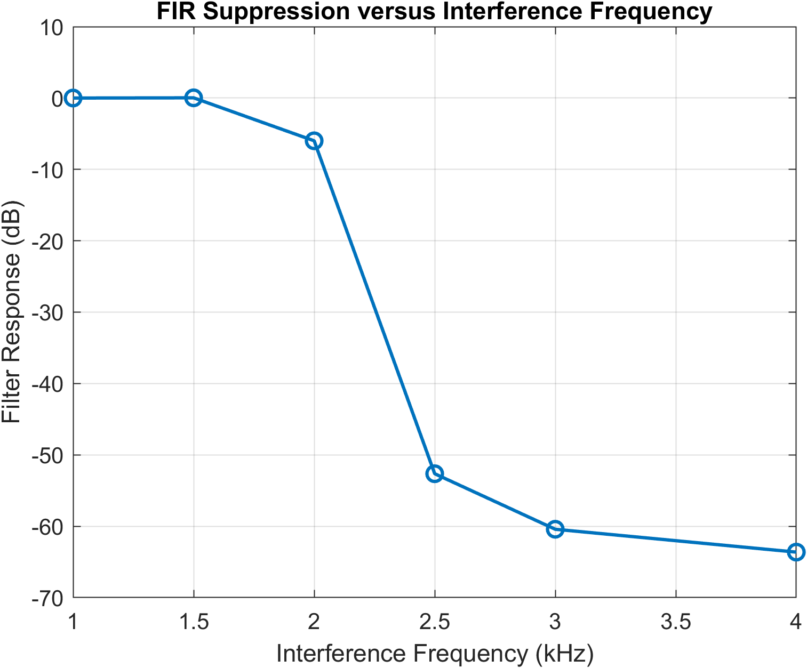

### Detection Strength

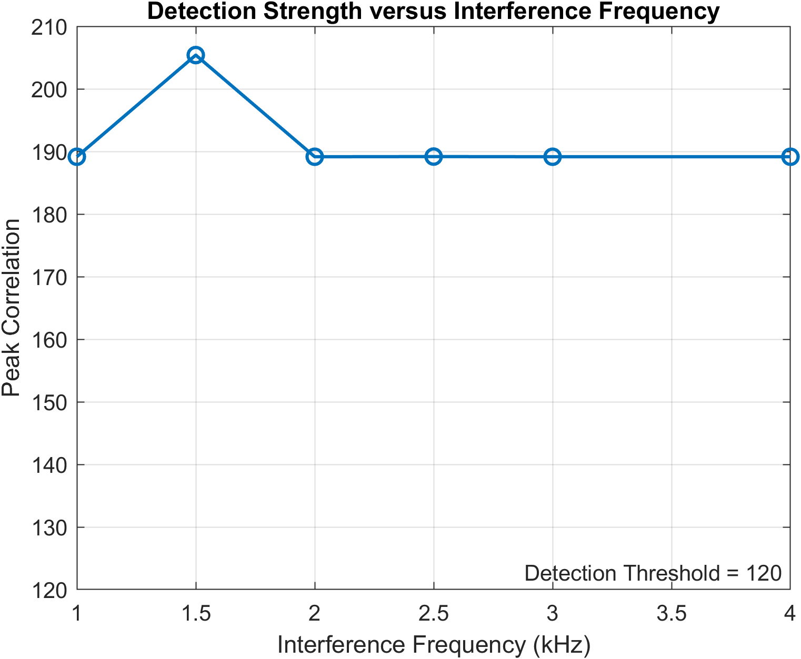


## 14. Why Interference Amplitude Was Not Swept

An initial idea was to keep the interferer fixed at 4 kHz and increase only its amplitude.

This was not retained as a primary experiment because the 4 kHz tone lies deep inside the FIR filter stopband.

Increasing the amplitude of an interferer that is already strongly rejected would provide limited additional insight into the filter's fundamental limitation.

Instead, moving the interferer toward the useful signal band provides a more informative engineering test because it demonstrates when frequency-selective filtering becomes less effective.

---

# Simulink Implementation

The receiver was independently reproduced as a Simulink block model.

The model includes:

- MATLAB-generated BPSK input,
- AWGN Channel,
- narrowband sinusoidal interference,
- Time Scope,
- Spectrum Analyzer before filtering,
- FIR receiver filter,
- Spectrum Analyzer after filtering,
- matched filter,
- correlation magnitude,
- threshold detector,
- detection output.

## Received Signal

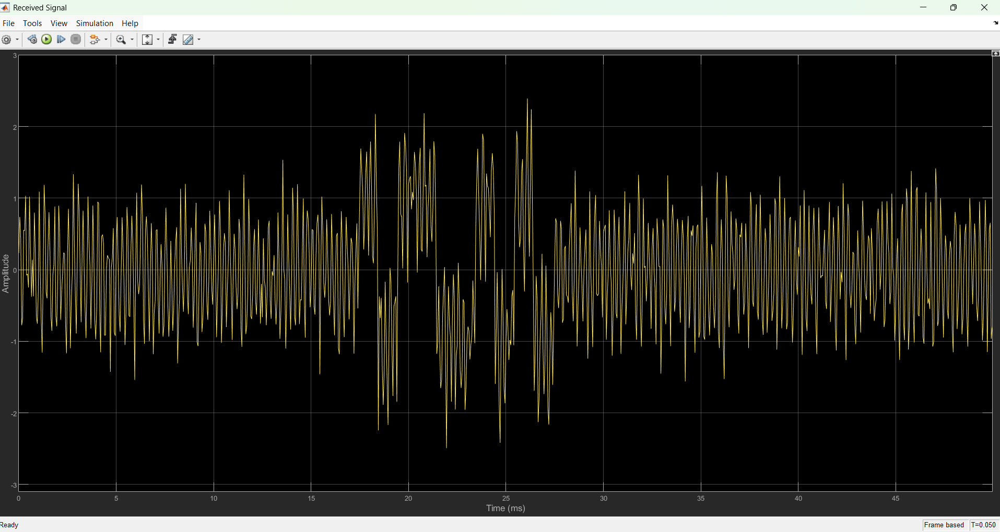

The received waveform contains the BPSK burst together with AWGN and narrowband interference.

## Spectrum Before Filtering

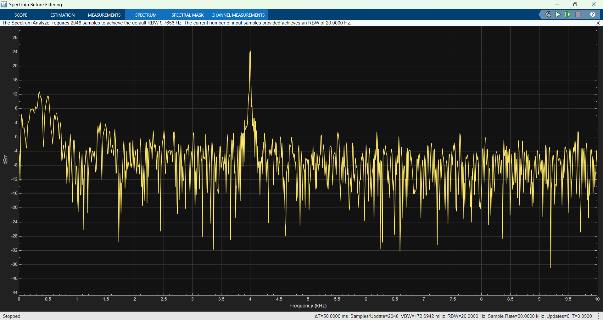

The Spectrum Analyzer clearly identifies the narrowband 4 kHz interferer.

## Spectrum After Filtering

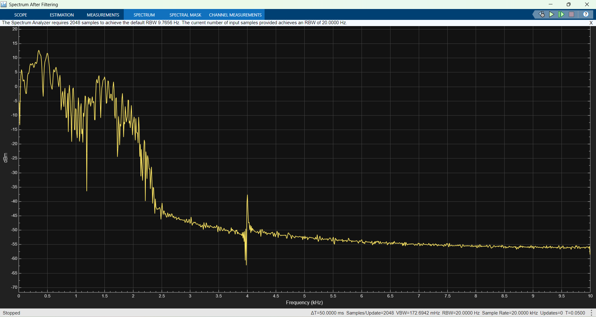

The 4 kHz component is strongly suppressed while the low-frequency baseband signal region is retained.

## Matched-Filter Output

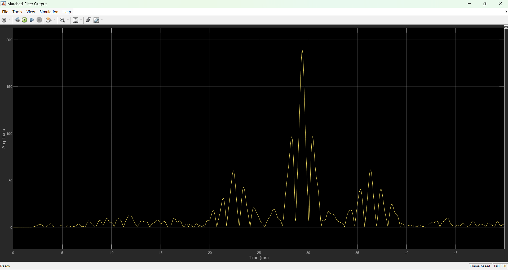

The matched-filter output produces a dominant peak when the received burst aligns with the known reference waveform.

## Detection Output

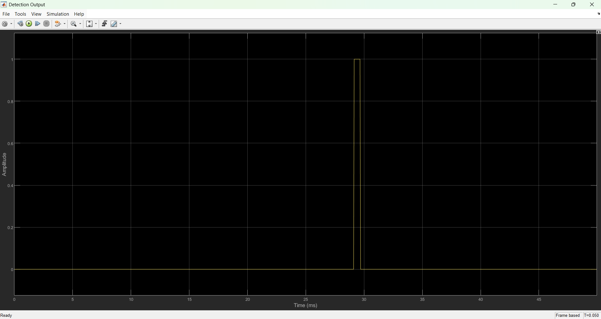

The threshold detector converts the matched-filter result into a binary detection pulse.

---

## 15. MATLAB and Simulink Roles

The two environments serve different purposes.

### MATLAB

Used for:

- signal generation,
- controlled experiments,
- FFT analysis,
- FIR design,
- numerical measurements,
- correlation,
- burst localization,
- Monte Carlo detection analysis,
- performance plots.

### Simulink

Used for:

- visual system-level signal flow,
- receiver block implementation,
- AWGN modeling,
- streaming spectrum visualization,
- matched-filter implementation,
- threshold detection,
- engineering scope-based observation.

The two implementations provide complementary validation of the receiver-processing concepts.

---

## 16. Project Structure

```text
communication-receiver-dsp-testbench/
│
├── src/
│   ├── generate_bpsk_burst.m
│   ├── add_channel_impairments.m
│   ├── apply_receiver_filter.m
│   ├── find_burst.m
│   └── detect_signal.m
│
├── experiments/
│   ├── experiment_01_clean_bpsk.m
│   ├── experiment_02_known_burst.m
│   ├── experiment_03_awgn.m
│   ├── experiment_04_interference.m
│   ├── experiment_05_fft_analysis.m
│   ├── experiment_06_filter_design.m
│   ├── experiment_07_filter_signal.m
│   ├── experiment_08_correlation_detection.m
│   ├── experiment_09_threshold_detection.m
│   ├── experiment_10_signal_absent.m
│   ├── experiment_11_detection_vs_snr.m
│   └── experiment_12_interference_frequency.m
│
├── simulink/
│   ├── receiver_dsp_testbench.slx
│   └── setup_receiver_model.m
│
├── validation/
│
├── results/
│   ├── matlab/
│   ├── simulink/
│   ├── headline_results.csv
│   ├── detection_vs_snr.csv
│   └── interference_frequency_sensitivity.csv
│
└── README.md
```

---

## 17. Requirements

The project was developed using MATLAB R2024b.

Relevant products include:

- MATLAB
- Simulink
- Signal Processing Toolbox
- DSP System Toolbox
- Communications Toolbox

The AWGN Channel block can be run using interpreted execution where a supported C/C++ compiler is not installed.

---

## 18. Running the MATLAB Experiments

Clone or download the repository and open the project directory in MATLAB.

Each experiment can be run independently from the `experiments/` folder.

The scripts automatically add the reusable functions in `src/` to the MATLAB path.

For example:

```matlab
run('experiments/experiment_09_threshold_detection.m')
```

---

## 19. Running the Simulink Receiver

First run:

```matlab
run('simulink/setup_receiver_model.m')
```

This creates the required workspace variables and filter coefficients.

Then open:

```text
simulink/receiver_dsp_testbench.slx
```

and run the simulation.

The Version 1 model uses a fixed-step discrete solver with:

```text
Sample time = 1 / 20000 s
Stop time   = 0.04995 s
```

---

## 20. Key Engineering Findings

The project produced several useful observations.

1. A narrowband interferer is much easier to identify in the frequency domain than from the corrupted time waveform alone.

2. The 4 kHz interferer was suppressed by approximately 69.78 dB in the measured baseline filtering experiment.

3. Correlation successfully localized the known burst at sample 350 with zero timing error under the baseline simulation conditions.

4. A correlation maximum alone is not sufficient evidence of signal presence because noise also produces accidental peaks.

5. Threshold detection successfully distinguished the baseline signal-present and signal-absent cases.

6. Detection probability must be interpreted together with false-alarm probability.

7. A detector that always declares a signal can have `Pd = 1` while still being unusable because `Pfa = 1`.

8. Frequency-selective FIR filtering works best when desired and interfering spectra are sufficiently separated.

9. When interference enters the filter passband, filtering alone becomes less effective, although correlation-based detection can remain robust because it exploits knowledge of the desired waveform.

10. MATLAB and Simulink produced consistent qualitative receiver behavior, providing algorithm-level and system-level views of the same processing chain.

---

## 21. Limitations

Version 1 intentionally remains a focused receiver-detection study.

The following effects are not yet modeled:

- multipath fading,
- carrier-frequency offset,
- sampling-clock offset,
- timing drift,
- pulse-shaping filters,
- symbol timing recovery,
- adaptive interference cancellation,
- automatic threshold optimization,
- carrier-based passband BPSK,
- complete bit recovery,
- BER evaluation,
- real SDR or RF measurements.

The detection threshold is currently a fixed heuristic based on 60% of the known reference energy.

The narrowband interferer is modeled as a sinusoidal tone rather than a second modulated communication signal.

The baseband BPSK waveform uses rectangular symbol pulses.

---

## 22. Why Bit Recovery Is Not Included

This project focuses on receiver signal processing and known-signal detection rather than full digital communication demodulation.

The receiver therefore stops after:

```text
interference suppression
→ matched filtering
→ burst detection
```

Full symbol decisions, recovered-bit comparison, BER analysis, modulation comparisons, and fading-channel demodulation are intentionally reserved for a separate Digital Communications System Simulator project.

This keeps the two projects technically distinct.

---

## 23. Possible Future Extensions

Possible Version 2 extensions include:

- adaptive detection thresholds,
- ROC analysis,
- normalized correlation,
- notch or adaptive interference suppression,
- modulated co-channel interferers,
- Rayleigh or Rician fading,
- timing and frequency offsets,
- pulse shaping,
- synchronization experiments,
- SDR-based signal acquisition,
- real recorded communication signals.

---

## 24. References

1. MathWorks, *AWGN Channel — Communications Toolbox documentation*.
2. MathWorks, *Spectrum Analyzer — DSP System Toolbox documentation*.
3. MathWorks, *Discrete FIR Filter — Simulink documentation*.
4. MathWorks, documentation and examples on matched filtering and known-signal detection.
5. J. G. Proakis, *Digital Communications*.
6. A. V. Oppenheim and R. W. Schafer, *Discrete-Time Signal Processing*.

---

## Status

**Version 1 — Complete**

The current version provides a reproducible MATLAB and Simulink receiver testbench for exploring spectral analysis, narrowband interference suppression, matched-filter detection, burst localization, threshold decisions, and detection robustness under changing noise and interference conditions.